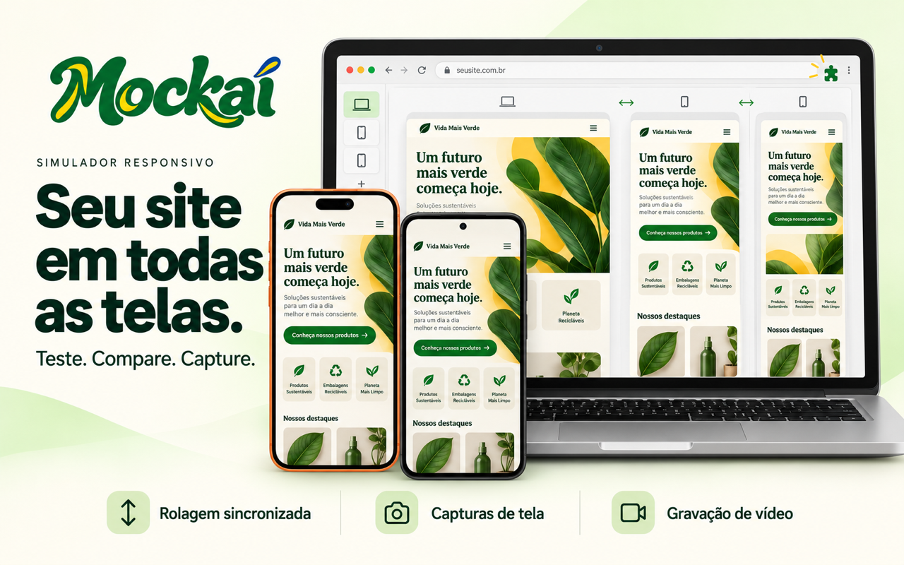

# Mockaí

**Seu site em todas as telas. Teste. Compare. Capture.**

O Mockaí é uma extensão para Chrome que permite visualizar seus sites em celulares, tablets e notebooks lado a lado, diretamente na página que você está acessando. Compare layouts responsivos, sincronize a rolagem e registre o resultado em imagens ou vídeos.

## Recursos

- **Até quatro telas simultâneas** para comparar o mesmo site em diferentes tamanhos.
- **Biblioteca de mockups** com modelos de celulares, tablets, notebooks e outros dispositivos.
- **Ajustes por tela** de largura, altura e orientação, além de escala de visualização.
- **Favoritos, perfis personalizados e conjuntos salvos** para reutilizar suas configurações.
- **Rolagem sincronizada** entre páginas acessíveis da mesma origem.
- **Capturas em PNG**, incluindo a moldura do dispositivo, e opção de captura da página inteira.
- **Gravação de vídeo** em WebM ou MP4, conforme o suporte do navegador.
- **Modos Navegador, PWA e Tela cheia** para ajustar a apresentação da prévia.
- **Tema claro e escuro** e interface em português, inglês e espanhol.

## Instalação local

Requer **Google Chrome 116 ou superior**. Esta pasta contém a extensão pronta para carregar, sem instalar dependências ou executar um build.

1. Clone este repositório ou baixe e extraia o ZIP.
2. Abra `chrome://extensions` no Chrome.
3. Ative o **Modo do desenvolvedor**.
4. Clique em **Carregar sem compactação**.
5. Selecione a pasta que contém o arquivo [`manifest.json`](manifest.json).
6. Fixe o **Mockaí** na barra de extensões para facilitar o acesso.

## Como usar

1. Acesse o site que deseja testar em uma aba HTTP ou HTTPS.
2. Clique no ícone do **Mockaí** e abra o simulador. Você também pode usar **Abrir no Mockaí** no menu de contexto da página.
3. Abra **Dispositivos**, busque um modelo e clique em **Adicionar**. É possível manter até quatro telas abertas.
4. Selecione uma tela e abra **Ajustes** para alterar dimensões, orientação e escala.
5. Para comparar a navegação, ative **Sincronizar rolagem** em **Ajustes → Preferências**.
6. Abra **Capturar** para salvar uma imagem, capturar a página inteira ou gravar um vídeo da tela selecionada.

Use os favoritos para encontrar seus modelos mais usados e salve conjuntos para recuperar uma combinação de telas. Os conjuntos guardam as configurações dos dispositivos; ao abri-los, o simulador usa a página da aba atual.

## Capturas e vídeos

A captura da tela selecionada gera um PNG com o conteúdo e a moldura do mockup, preservando a transparência ao redor do dispositivo. Mantenha o mockup inteiro visível e ajuste a escala quando necessário.

As gravações são **sem áudio**, com limite de **dois minutos ou 64 MiB**. O formato MP4 e a conversão de WebM para MP4 dependem dos codecs disponíveis no navegador. A captura e a conversão são processadas localmente.

## Sobre a simulação

O Mockaí oferece prévias responsivas em molduras de dispositivos. O navegador e o agente de usuário continuam sendo os do computador; a extensão não reproduz o hardware nem o motor de renderização de um celular real.

Alguns sites podem restringir a exibição em quadros, autenticação ou cookies e impedir o carregamento da prévia. A sincronização de rolagem depende de documentos acessíveis na mesma origem e não acompanha painéis internos com rolagem própria. Páginas internas ou protegidas do navegador não são suportadas.

## Estrutura do projeto

| Pasta ou arquivo | Conteúdo |
| --- | --- |
| [`manifest.json`](manifest.json) | Configuração da extensão e permissões do Chrome, usando Manifest V3. |
| [`background/`](background/) | Serviço em segundo plano e coordenação das sessões. |
| [`content/`](content/) | Interface do simulador inserida na página. |
| [`popup/`](popup/) | Painel aberto pelo ícone da extensão. |
| [`shared/`](shared/) | Modelos de dispositivos, configurações, idiomas e utilitários compartilhados. |
| [`mockups/`](mockups/) | Molduras dos dispositivos e catálogo de arquivos. |
| [`offscreen/`](offscreen/) | Processamento de captura e gravação. |
| [`export/`](export/) | Prévia, download e conversão de arquivos. |
| [`_locales/`](_locales/) | Traduções dos metadados e mensagens da extensão. |
| [`img/`](img/) | Logo, ícones e imagem de apresentação. |

## Desenvolvimento

Esta distribuição usa HTML, CSS e JavaScript com módulos nativos. Após editar os arquivos:

1. Abra `chrome://extensions` e clique em **Recarregar** no cartão do Mockaí.
2. Recarregue a página em que estiver testando a extensão.
3. Abra novamente o simulador para verificar as alterações.

## Contribuições

Para relatar um problema, abra uma issue com a versão do Chrome, os passos para reproduzir, o dispositivo selecionado e o resultado esperado. Quando possível, inclua uma captura de tela e uma URL pública que permita reproduzir o comportamento.
